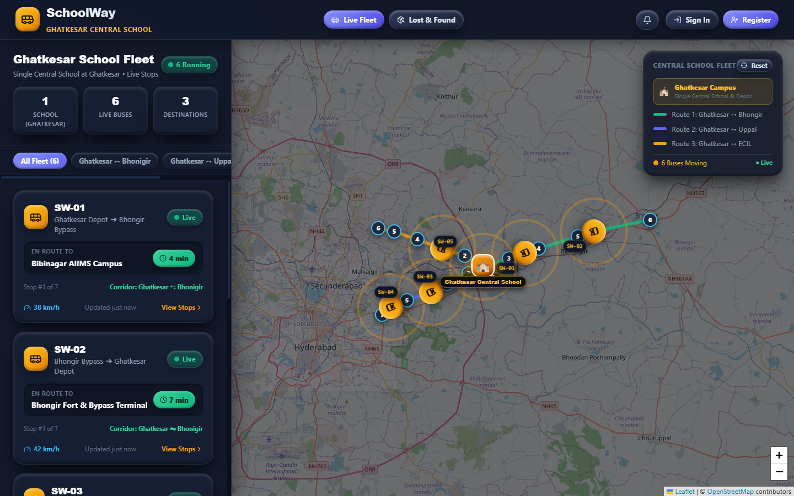
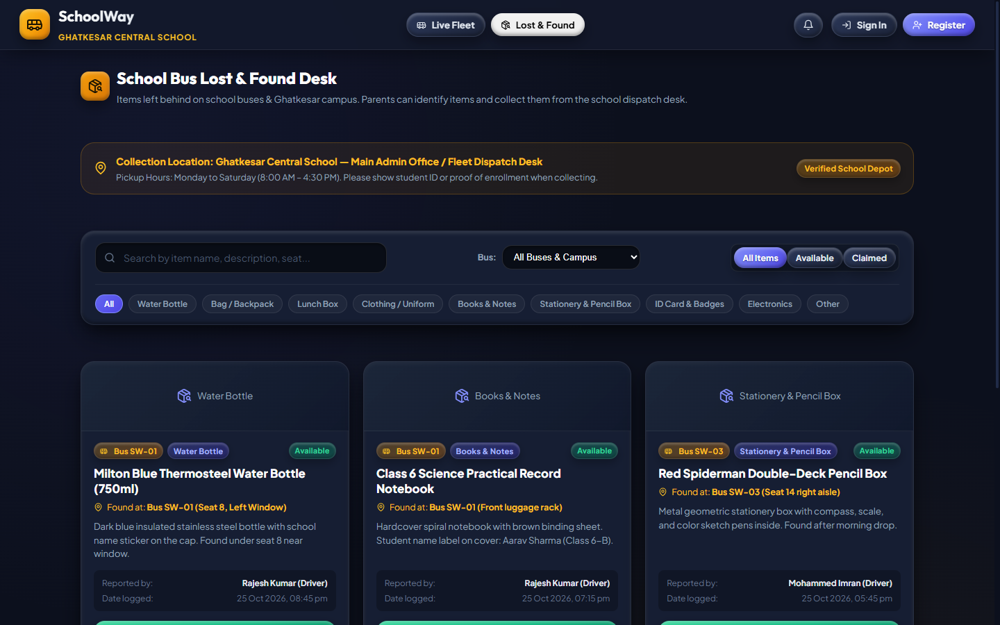
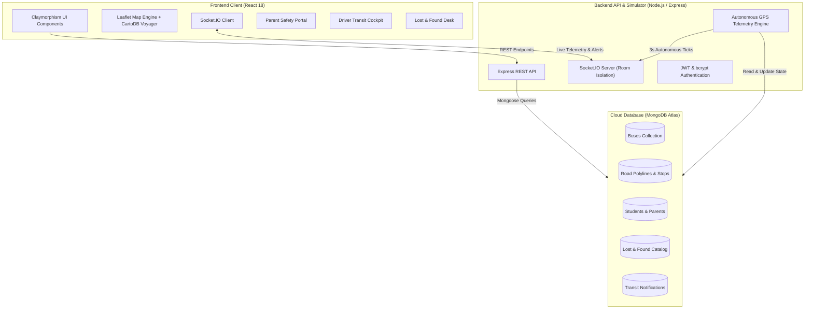

# 🏫 SchoolWay — Real-Time School Bus Fleet Tracking & Student Safety Platform

<div align="center">

[](https://school-way-eosin.vercel.app/)
[](https://nodejs.org/)
[](https://www.mongodb.com/atlas)
[](https://socket.io/)
[](https://school-way-eosin.vercel.app/)

**A modern, full-stack school bus tracking and student transit safety platform for schools, parents, and fleet operators.**  
*Continuous road-following GPS telemetry &bull; Dynamic stop ETAs &bull; Integrated bus lost & found desk &bull; Automated boarding attendance*

👉 **[Launch Live Web Application](https://school-way-eosin.vercel.app/)** 👈

</div>

---

## 🌟 Overview

**SchoolWay** bridges the communication and safety gap between school administration, bus drivers, and parents. By combining real-time GPS telemetry, road-snapped navigation algorithms, and role-based portals, SchoolWay replaces outdated paper schedules and frantic phone calls with an intuitive, unified transit intelligence dashboard.

---

## 📸 User Interface Showcase

### 1. Real-Time Fleet Radar & City Transit Map
*Live road-following GPS telemetry streamed via WebSockets across arterial school bus routes with stop milestones, speed gauges, and active fleet statuses.*

<div align="center">
  
</div>

<br/>

### 2. School Bus Lost & Found Operations Desk
*Centralized lost property management enabling drivers to report items left behind on buses with photos and descriptions, while parents browse and submit verified claim inquiries.*

<div align="center">
  
</div>

---

## 🎯 The 4 Core Challenges SchoolWay Solves

Traditional school bus transportation systems leave parents anxious and school administrators overwhelmed. SchoolWay is purposefully engineered to eliminate the four biggest pain points in student transit:

```
┌────────────────────────────────────────────────────────────────────────────────────────┐
│                                 THE 4 CORE CHALLENGES                                  │
├─────────────────────┬─────────────────────┬─────────────────────┬──────────────────────┤
│  1. NO LIVE GPS     │  2. NO DYNAMIC ETA  │  3. NO LOST & FOUND │  4. NO ATTENDANCE    │
│  "Where is the bus  │  "When will it      │  "Child forgot bag, │  "Did my child       │
│   right now?"       │   actually arrive?" │   how do I find it?"│   safely board?"     │
└─────────────────────┴─────────────────────┴─────────────────────┴──────────────────────┘
```

### 1. 📍 No Live Location Visibility
* **The Problem**: Parents and school dispatchers have no way of knowing where buses are physically located once they depart the depot. Families wait by roadsides in harsh weather, while school phone lines get choked with parents asking where their children are.
* **How SchoolWay Solved It**:
  * **Continuous 3-Second Telemetry**: Emits high-frequency GPS position ticks over bi-directional WebSocket channels (`bus:location_update`).
  * **True Road-Snapped Geometry**: Buses navigate along genuine **OSRM road-following polylines** (not unrealistic straight lines between points) following actual highways and city streets.
  * **Smooth Bearing & Glide Interpolation**: Client-side motion interpolation rotates the directional vehicle marker to match exact road heading and lane movements.

---

### 2. ⏱️ No Dynamic ETAs (Estimated Time of Arrival)
* **The Problem**: Fixed paper timetables collapse the moment morning traffic congestion or road diversions occur. Parents and students frequently miss the bus or end up waiting for 30+ minutes without knowing whether the vehicle is delayed or has already passed.
* **How SchoolWay Solved It**:
  * **Real-Time Distance & Velocity Calculations**: Dynamically computes **stop-by-stop ETAs in minutes** for every upcoming stop along the bus route.
  * **Proximity Transit Alerts**: Pushes automated notifications when a bus is within ~5 minutes of a student's assigned stop.
  * **Traffic Delay Advisories**: Automatically detects road slowdowns and broadcasts alert banners to affected parents in real time.

---

### 3. 🎒 No Lost & Found Management
* **The Problem**: Children routinely leave water bottles, lunchboxes, uniform sweaters, and project kits on school buses. Because there is no communication bridge between drivers, depots, and parents, lost items accumulate in bus yards or end up permanently lost.
* **How SchoolWay Solved It**:
  * **Integrated Lost & Found Desk**: A dedicated digital repository accessible to parents, drivers, and school administrators.
  * **Rapid Driver / Staff Reporting**: Bus drivers and depot staff can immediately log found items with photo uploads or descriptions, bus numbers, seat positions, and timestamps.
  * **One-Click Parent Claim Flow**: Parents can browse the catalog, inspect item details, view official depot pickup instructions, and submit a **"🙋 This is My Child's Item"** claim inquiry directly to the administration.

---

### 4. 📋 No Real-Time Attendance & Boarding Verification
* **The Problem**: Once a child walks out the door to catch the bus, parents experience hours of uncertainty not knowing whether their child safely boarded the bus or entered the school gates.
* **How SchoolWay Solved It**:
  * **Automated Proximity Boarding**: As the bus dwells at a student's designated stop, the platform verifies proximity and updates student status to `Onboard & Verified`.
  * **Driver Cockpit Passenger Roster**: Drivers have a digital passenger checklist to manually verify individual student boarding (`boarded`, `dropped`, or `absent`).
  * **Targeted Parent Notifications**: Parents receive instant boarding confirmations (*"Boarding Confirmed: Aarav Sharma is safely onboard Bus SW-01"*), filtered strictly to their registered children.

---

## 🏗️ Architecture & Data Flow



---

## 🛠️ Technology Stack

### Frontend
| Technology | Role |
| :--- | :--- |
| **React 18** | Declarative component architecture with modern hooks (`useState`, `useEffect`, `useContext`, `useRef`, `useCallback`) |
| **Vite 5** | High-performance build tool and hot module replacement |
| **Leaflet 1.9** | Interactive mapping engine with smooth tile rendering |
| **CartoDB Voyager** | Clean, high-legibility cartographic vector/raster tile basemap |
| **Vanilla CSS** | Bespoke **Tactile Claymorphism** design system with 3D volumetric depth, soft pillowy cards, multi-layered inset shadows, and micro-interactions |
| **Socket.IO Client** | Bi-directional, event-driven WebSocket communication |
| **Lucide React** | Consistent and crisp vector icons |

### Backend
| Technology | Role |
| :--- | :--- |
| **Node.js (v18+)** | High-throughput asynchronous JavaScript runtime |
| **Express 4.19** | RESTful API routing, error handling, and middleware |
| **Socket.IO 4.7** | Real-time WebSocket server featuring room-segregated broadcasts (`fleet:all`, `bus:<id>`, `parent:<id>`) |
| **OSRM Engine** | Open Source Routing Machine integration for realistic driving geometry and route snapping |
| **JWT & bcryptjs** | Secure token-based session management and cryptographic password hashing |

### Database
| Technology | Role |
| :--- | :--- |
| **MongoDB Atlas** | High-availability cloud NoSQL database cluster |
| **Mongoose 8** | Schema validation, relationship modeling, and geospatial indexing |

---

## 🗺️ Transit Corridors & Stops

SchoolWay models high-traffic school bus routes connecting regional communities to the central campus depot (`17.4560, 78.6830`):

| Route Code | Corridor | Major Stops & Milestones |
| :--- | :--- | :--- |
| **ROUTE-BHONIGIR** | Ghatkesar &harr; Bhongir (NH 163) | Ghatkesar RTC Stand &bull; Pagidipalli &bull; Kondamadugu &bull; Bibinagar AIIMS &bull; Bhongir Fort & Bypass |
| **ROUTE-UPPAL** | Ghatkesar &harr; Uppal (Warangal Highway) | Pocharam Infosys SEZ &bull; Narapally Junction &bull; Medipally &bull; Peerzadiguda &bull; Boduppal &bull; Uppal Metro |
| **ROUTE-ECIL** | Ghatkesar &harr; ECIL (Keesara Road) | Ghatkesar ORR &bull; Keesara X Roads &bull; Rampally &bull; Nagaram Junction &bull; Kushaiguda &bull; ECIL Depot |

---

## 💻 Local Development Setup

To run the project locally on your machine:

### 1. Clone the Repository
```bash
git clone https://github.com/uppalanchiabhiram235235-hue/SchoolWay.git
cd SchoolWay
```

### 2. Install Dependencies
```bash
# Install root, server, and client dependencies
npm install
npm --prefix server install
npm --prefix client install
```

### 3. Environment Variables
Create a `.env` file in the `server` directory:
```env
PORT=5000
MONGO_URI=mongodb+srv://<username>:<password>@cluster.mongodb.net/schoolway?retryWrites=true&w=majority
JWT_SECRET=your_secret_jwt_key
SIM_MODE=demo
CLIENT_URL=http://localhost:5173
```

### 4. Seed Database & Start
```bash
# Seed initial routes, buses, and lost & found data
npm --prefix server run seed

# Start both backend and frontend development servers concurrently
npm run dev
```

* **Frontend**: `http://localhost:5173`
* **Backend API**: `http://localhost:5000`

---

## 🌐 Live Web Application

The live frontend application is hosted on Vercel:  
👉 **[https://school-way-eosin.vercel.app/](https://school-way-eosin.vercel.app/)**
